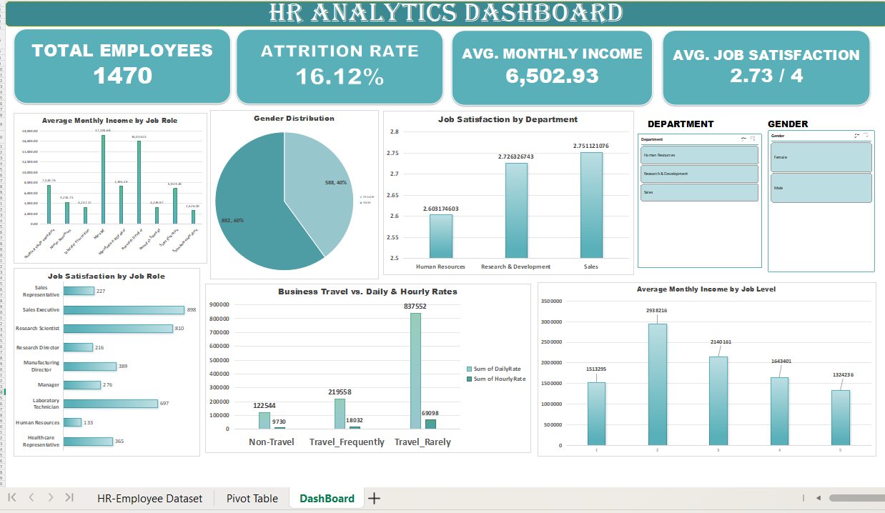

# 📊 HR Analytics Dashboard | Excel

## 📌 Project Overview

This project focuses on analyzing employee data to understand workforce trends, employee satisfaction, and employee attrition using Microsoft Excel.

An interactive HR Analytics Dashboard was developed to transform raw employee data into meaningful insights and help understand workforce performance through data visualization and Pivot Tables.

## 🎯 Project Objectives

- Analyze employee attrition and workforce distribution.
- Understand employee satisfaction across departments.
- Analyze average monthly income by job role and job level.
- Identify employee distribution by age, gender, and department.
- Explore factors related to employee attrition.
- Present HR insights through an interactive dashboard.

## 🛠️ Tools & Technologies

- Microsoft Excel / WPS Office
- Pivot Tables
- Pivot Charts
- Excel Formulas
- Slicers
- Data Cleaning
- Data Visualization

## 📊 Dashboard Preview

## 📈 Key Performance Indicators (KPIs)

| **KPI Metric** | **Dashboard Value** |

| 👥 Total Employees ----------|**1,470** |
| 📉 Attrition Rate -----------|**16.12%** |
| 💰 Average Monthly Income ---|**6,502.93** |
| ⭐ Average Job Satisfaction---|**2.73 / 4** |

## 📋 Dashboard Analysis
The dashboard includes the following analysis:
- Employee distribution by department.
- Employee attrition analysis.
- Average monthly income by job role.
- Average salary by job level.
- Job satisfaction by department.
- Performance rating distribution.
- Employee demographics and workforce analysis.

## 🎛️ Interactive Features
- Department slicer for department-wise analysis.
- Gender slicer for gender-based filtering.
- Interactive Pivot Charts.
- Dynamic dashboard filtering.

## 💡 Business Value
This dashboard helps HR teams explore workforce trends, understand employee satisfaction, monitor attrition, and compare income and performance across different employee groups.

## 🚀 Conclusion
This project demonstrates how Excel can be used for HR data analysis, data cleaning, Pivot Table analysis, and interactive dashboard creation.
It helped strengthen my practical skills in data analysis, data visualization, and extracting meaningful insights from employee data.

**Project Category:** Data Analytics | HR Analytics  
**Tools:** Excel | Pivot Tables | Pivot Charts | Slicers
