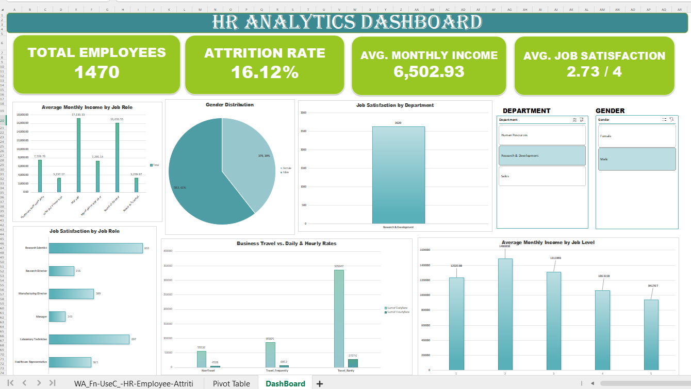

# HR Analytics Dashboard 

## Dashboard Preview

## Project Overview
This project focuses on analyzing employee data to understand workforce trends and employee attrition using Excel.

## Tools Used
- Microsoft Excel / WPS Spreadsheet
- Pivot Tables and Pivot Charts
- KPI Cards
- Interactive Slicers

## Key Performance Indicators (KPIs)
- Total Employees
- Employee Attrition Rate
- Average Monthly Income
- Average Job Satisfaction

## Dashboard Features
- Gender distribution analysis
- Average monthly income by job role
- Job satisfaction by department and job role
- Business travel analysis
- Average monthly income by job level
- Interactive filtering using Department and Gender slicers

## Objective
To transform employee data into an interactive dashboard that makes workforce information easier to understand and supports data-driven decision-making.

## Project File
The Excel workbook is available in this repository for viewing and exploration.
